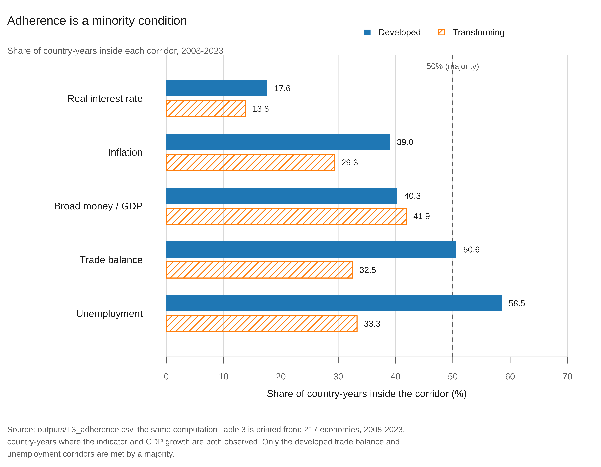

# Policy corridors as a diagnostic: the R code and data

The R code and data reproducing every figure and table in:

> Tavadyan, A. and Tavadyan, A. (2026). *Policy Corridors and Institutional Quality:
> A Diagnostic for 217 Economies since 1960.*

Archived on Zenodo: [10.5281/zenodo.22274239](https://doi.org/10.5281/zenodo.22274239).



## Contents

| Path | What it is |
|---|---|
| `R/panel.R` | The canonical 217-economy sample drawn from the detailed panel (drops the eight World Bank aggregates). Sourced by the scripts below; not run on its own |
| `R/historical_test.R` | Long-panel adherence, 1960–2023: by era, growth take-offs, and the event-time series (**Figures 2 and 4, Table 3, §4.2 and §4.5**). Writes `data/historical_20260816/` |
| `R/necessity_test.R` | The corridor test (below / inside / above each bound) and the necessity check (**Figure 3, Table 5, §4.4 and §4.6**). Writes `data/necessity_20260816/` |
| `R/joint_compliance.R` | The joint-score forward outcomes, the pre-trends check and Benjamini–Hochberg multiplicity (**§4.6 and the supplementary material, joint-score group**). Writes `data/joint_results_table.csv` |
| `R/fetch_external.R` | Downloads the three external series into `data/ext/`: the Worldwide Governance Indicators (World Bank API, source 3) and the Romelli central bank independence file, which also carries the Laeven–Valencia crisis dummies and the democracy index. Not shipped, run first |
| `R/external.R` | Shared set-up for the two scripts below: panels, take-off starts, crisis onsets. Sourced, not run on its own |
| `R/foundations_validation.R` | Bound perturbations, random corridors of equal width, crisis validation, institutional quality and central bank independence (**Tables C.1 and C.2, §4.5 and §4.6**). Writes `data/foundations/` |
| `R/crisis_table.R` | New crisis periods by corridors maintained (**Table 6**). Writes `data/foundations/` |
| `R/takeoff_threshold_sweep.R` | The take-off gap under 60 rules (**Table C.3**). Writes `data/foundations/` |
| `R/export_adherence_panel.R` | Writes the released adherence dataset, both panels, to `data/` |
| `R/make_tables.R` | Renders **Tables 2, 3, 4, 5, 6, B.1 and C.1–C.3** from the panels and the intermediates above. Writes `outputs/` |
| `R/make_figures.R` | Renders **Figures 1–4** from `outputs/T3_adherence.csv` and the intermediates. Writes `plots/` |
| `data/magic_squares_data_clean.csv` | The detailed panel, 2008–2023, 217 economies (five indicators). Frozen January 2026 |
| `data/wdi_long_1960_2023.csv` | The long panel, 1960–2023, three back-reaching indicators (World Bank WDI, pulled 4/16 August 2026) |
| `data/adherence_panel_long_1960_2023.csv` | The released dataset, long panel: indicator values, the corridor flags for each economy-year and the joint score (K3) |
| `data/adherence_panel_detailed_2008_2023.csv` | The released dataset, detailed panel: the same for five corridors (K4, K5) |
| `plots/` | Figures 1–4 as published (PNG) |
| `outputs/` | Where `make_tables.R` writes the tables (pandoc pipe format); empty until you run it |

The generated table files are named by build order, not by manuscript number:
`T3_adherence` → **Table 2**, `T4_adherence_by_era` → **Table 3**, `T6_shock_years` → **Table 4**,
`T5_corridor_test` → **Table 5**, `T7_crisis_onsets` → **Table 6**, `T2_data_coverage` → **Table B.1**,
`TC1_bound_shifts`, `TC2_other_systems`, `TC3_takeoff_rules` → **Tables C.1–C.3**. Table 1 is the framework's
normative bounds and is stated in the manuscript, not computed.

## Reproducing the figures and tables

Base R, plus `here` (anchors paths to this directory via the empty `.here` marker), `jsonlite`
and `haven` for the external series, and, for the figures, `ragg` (falls back to base `png()` if
absent). No API keys. Run from the repository root, in this order:

```sh
Rscript R/historical_test.R      # -> data/historical_20260816/
Rscript R/necessity_test.R       # -> data/necessity_20260816/
Rscript R/joint_compliance.R     # -> data/joint_results_table.csv
Rscript R/fetch_external.R       # -> data/ext/
Rscript R/foundations_validation.R   # -> data/foundations/  (about 50 minutes)
Rscript R/crisis_table.R         # -> data/foundations/
Rscript R/takeoff_threshold_sweep.R  # -> data/foundations/
Rscript R/export_adherence_panel.R   # -> data/adherence_panel_*.csv
Rscript R/make_tables.R          # -> outputs/  (Tables 2-6, B.1, C.1-C.3)
Rscript R/make_figures.R         # -> plots/    (Figures 1-4)
```

`historical_test.R` and `necessity_test.R` each write a folder of intermediate CSVs
(`data/historical_20260816/`, `data/necessity_20260816/`), created on run and git-ignored;
`joint_compliance.R` writes `data/joint_results_table.csv`. `make_tables.R` and `make_figures.R`
read the intermediates; `data/foundations/` and `data/ext/` are created on run and git-ignored.
Bootstrap and draw counts can be lowered for a quick pass with `B_BOOT` and `NDRAW` (defaults 2,000
and 1,000), at the cost of not reproducing the published intervals. Every plotted and tabulated value is read from a file at run
time, so a figure or table cannot drift from the numbers behind it.

## The data

Two panels, both from the World Bank World Development Indicators.

The **detailed panel** (`magic_squares_data_clean.csv`, 2008–2023) is frozen as extracted in
January 2026. A fresh WDI pull does **not** reproduce it: the World Bank revises the series and
has renamed identifiers, so a later release moves observations. The manuscript reports that
adherence is stable under this revision (the largest single cell moves 2.2 points, the two group
means 0.1 and 0.9), but the frozen file is what the published numbers were built from and is the
file to use.

The **long panel** (`wdi_long_1960_2023.csv`) was pulled from WDI on 16 August 2026 for the three
indicators that reach back to 1960: inflation (`FP.CPI.TOTL.ZG`), broad money as a share of GDP
(`FM.LBL.BMNY.GD.ZS`) and the trade balance (`NE.RSB.GNFS.ZS`), together with GDP growth
(`NY.GDP.MKTP.KD.ZG`) and GDP per capita in constant 2015 US dollars (`NY.GDP.PCAP.KD`) for the
outcome and the development classification. Unemployment and the real lending rate do not reach
back far enough, which is why the long panel scores three corridors rather than five. A re-pull
will differ for the same reason as the detailed panel; the frozen file reproduces the paper.

## External series

Sections 4.5 and 4.6 use three series that are downloaded by `fetch_external.R` and not redistributed
here:

- **Crisis dates**: Laeven and Valencia's systemic banking, currency and sovereign debt crises, as
  coded in the replication file of Romelli (2022), Harvard Dataverse
  [10.7910/DVN/2KMIVW](https://doi.org/10.7910/DVN/2KMIVW), file 6062520 (CC0).
- **Central bank independence**: the CBIE index from the same file, 1972–2017.
- **Institutional quality**: the mean of four Worldwide Governance Indicators (government
  effectiveness, regulatory quality, rule of law, control of corruption), 1996–2023, World Bank API
  source 3 (CC BY 4.0). The paper's pull was made on 4 October 2026 against the 25 September 2026
  update; a later pull may differ.

The adherence datasets in `data/` contain WDI-derived values only (CC BY 4.0).
